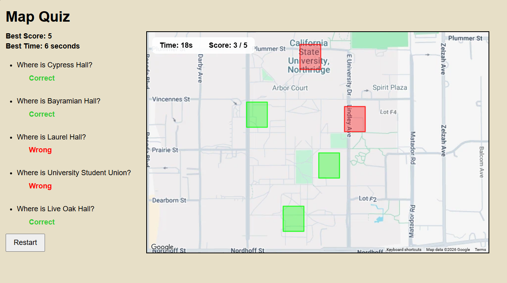

# CSUN Campus Map Quiz

## Project Description
This project is a JavaScript assignment for my COMP 484 where I created a campus map quiz using HTML, CSS, JavaScript, and the Google Maps API. The goal is to identify different buildings on the CSUN campus by double-clicking their locations on the map.

## Features
- Five campus location questions.
- Green and red rectangles to show correct and incorrect answers.
- Score tracking.
- Timer to track completion time.
- Saves the best score and fastest perfect time using local storage.
- Start and restart buttons.

## Technologies Used
- HTML
- CSS
- JavaScript
- Google Maps JavaScript API

## How to Run
The project was originally run in a web browser using the Google Maps API. However, the API trial has expired, so the map may no longer load and the application is currently not fully functional.

The screenshot below will show what the project looked like when it was working.

## What I Learned
This project helped me practice JavaScript objects, event handling, DOM manipulation, working with APIs, and saving data with local storage.